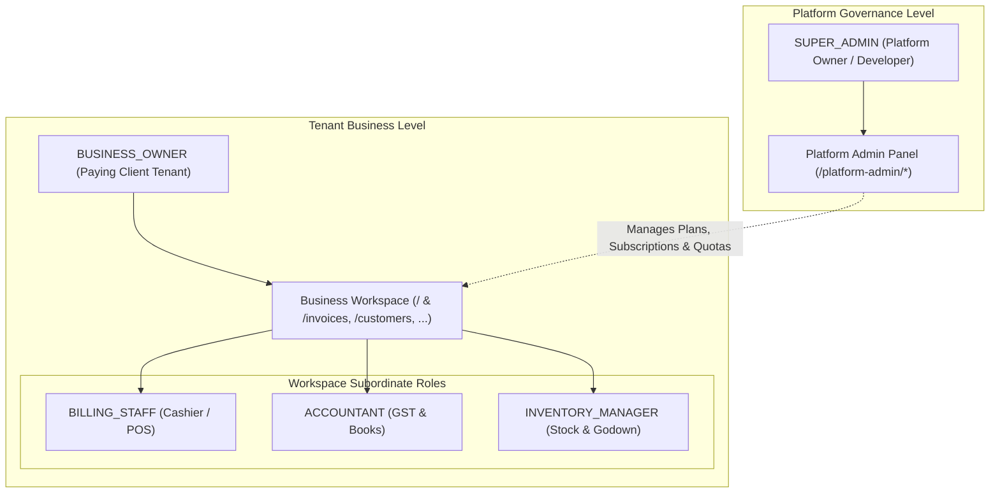

# Lenden Platform Architecture Plan

> **Phase Status:** Architecture Planning & Dashboard Navigation Phase  
> **Notice:** Authentication, database persistence, and authorization guards are planned specifications for upcoming implementation phases. This document serves as the formal architectural blueprint. Do not treat these specifications as implemented until fully built and test-verified.

---

## 1. Executive Overview & Account Model

Lenden is a multi-tenant commercial billing, GST invoicing, and Udhaar ledger platform designed for Indian small and medium businesses (SMBs). To cleanly decouple platform developer governance from client business operations, the architecture explicitly defines **two primary account types** along with workspace-level subordinate roles:

---

## 2. Primary Account Types & Subordinate Roles

### 2.1 Primary Account Type 1: `SUPER_ADMIN` (Platform Owner / Developer)
* **Scope:** Global platform level.
* **Identity:** Platform founder, core engineers, and platform administrators.
* **Context:** Operates across all tenants without belonging to any single business workspace.
* **Core Capabilities:**
  1. **Business Account Management:** View, search, inspect, and manage all client business workspaces.
  2. **Subscription Lifecycle Control:** Activate, suspend, renew, or extend trial grace periods for client accounts.
  3. **Plan & Quota Configuration:** Configure commercial tiers (e.g., Starter, Growth Pro, Enterprise Multi-Branch), adjusting billing counter quotas, branch allowances, staff seat limits, WhatsApp reminder allocations, and invoice limits.
  4. **Platform-Wide Financial Intelligence:** Review aggregate monthly recurring revenue (MRR), subscriber growth, churn rate, and system usage telemetry.
  5. **Platform Settings & Integrations:** Manage global third-party credentials (Razorpay/Stripe payment gateways, NIC GST e-invoicing GSP APIs, Meta WhatsApp Cloud API credentials) and security audit log retention rules.

### 2.2 Primary Account Type 2: `BUSINESS_OWNER` (Paying Client Tenant Owner)
* **Scope:** Scoped strictly to their single dedicated `business_id` workspace.
* **Identity:** The proprietor, managing partner, or authorized business director who registers the company and pays the subscription.
* **Core Capabilities:**
  1. **Strict Data Boundary:** Access only their own business workspace and transactions.
  2. **Workspace Profile & Legal Setup:** Edit trade name, registered legal entity, logo, physical address, state jurisdiction, GSTIN, and custom invoice print branding.
  3. **Commercial Operations:** Create and issue tax invoices, manage customer Udhaar credit ledgers, record vendor purchase bills, manage product inventory and HSN/SAC catalogs, track expenses, generate GSTR-1/P&L reports, and dispatch WhatsApp payment reminders.
  4. **Staff Delegation:** Invite and manage staff members within their business workspace, assigning designated operational roles based on their subscription tier seat limit.
  5. **Subscription Self-Service:** View active plan details, monitor usage against quotas, upgrade plan tiers, purchase add-on counters/branches, and download tax invoices for their SaaS subscription.

### 2.3 Workspace-Level Subordinate Roles (Business RBAC)
These are **business-level permission profiles**, strictly internal to a single business workspace. They are **NOT** platform-owner accounts and have zero access to platform administration or other businesses.

| Subordinate Role | Intended User | Permission Scope within Workspace |
| :--- | :--- | :--- |
| `BILLING_STAFF` | Counter Cashier / Sales Operator | Invoicing, POS billing, day-book cash collection, customer lookup. Cannot view profit margins, tax summaries, or workspace settings. |
| `ACCOUNTANT` | Chartered Accountant / In-house Bookkeeper | Financial ledgers, GSTR-1 summaries, balance sheet, expense recording, payment reconciliations. Read/write access to financial records. |
| `INVENTORY_MANAGER` | Godown Manager / Store In-charge | Product catalog, stock adjustments, barcode scanning, purchase orders, vendor invoices, low-stock alerts. |

---

## 3. Planned Navigation Groups

The dashboard UI partition enforces clean visual and logical separation between the two functional scopes:

### Navigation Group A: Business Workspace (Client Portal)
* **Target Audience:** `BUSINESS_OWNER` and subordinate business staff (`BILLING_STAFF`, `ACCOUNTANT`, `INVENTORY_MANAGER`).
* **Route Structure:**
  - `/` — Dashboard Overview (Sales KPIs, cash flow, Udhaar watchlist, GST preview)
  - `/invoices` — Billing & Invoices (GST tax invoices, delivery challans, credit notes)
  - `/customers` — Customers & Udhaar (Khata credit ledger, statements, reminders)
  - `/inventory` — Products & Inventory (Stock catalog, HSN codes, low-stock warnings)
  - `/purchases` — Purchases & Suppliers (Vendor bills, input tax credit)
  - `/expenses` — Expenses (Petty cash, operating expenses, logistics)
  - `/reports` — Reports & Taxes (Sales register, GSTR-1, P&L, balance sheet)
  - `/whatsapp` — WhatsApp Automation (Automated PDF delivery, UPI reminder broadcasts)
  - `/staff` — Staff & Permissions (Workspace staff RBAC & delegated roles)
  - `/subscription` — My Subscription (Client self-serve plan details & add-ons)
  - `/settings` — Business Settings (Business name, logo, address, GSTIN, invoice templates)

### Navigation Group B: Platform Admin Panel (Platform Owner Scope)
* **Target Audience:** `SUPER_ADMIN` only.
* **Route Structure:**
  - `/platform-admin` — Platform Overview (Global MRR, subscriber count, platform uptime)
  - `/platform-admin/businesses` — Business Accounts (Manage tenant accounts, activate, suspend, renew)
  - `/platform-admin/plans` — Plans & Feature Limits (Configure pricing, counter quotas, branch limits)
  - `/platform-admin/settings` — Platform Settings (Global credentials, public registration policies)

---

## 4. Security Architecture Requirements for Future Implementation

When authentication and database persistence are developed in upcoming phases, the following strict architectural requirements must be enforced:

### 4.1 Zero-Trust Client Context
* **Rule:** Never trust a role, permission claim, or `business_id` supplied by the browser client, URL parameter, or request payload without cryptographic server-side authorization.
* **Mechanism:** Every incoming request must be authenticated via an HTTP-only, secure, SameSite session cookie containing a cryptographically signed session ID. The server must validate the user identity, role, and active tenant binding on each protected call.

### 4.2 Public Registration Guardrails
* **Rule:** Do not allow public registration to create `SUPER_ADMIN` accounts under any circumstance.
* **Mechanism:** Public sign-up routes (`/auth/signup` or `/register`) will strictly and exclusively provision a `BUSINESS_OWNER` account attached to a freshly created business tenant record with a trial status. `SUPER_ADMIN` accounts must only be provisioned via protected server-side CLI seed scripts or secure platform-owner database migrations.

### 4.3 Mandatory Business-Level Data Isolation
* **Rule:** Enforce business-level data isolation on every protected server operation and database query.
* **Mechanism:** 
  1. All domain tables (`invoices`, `customers`, `products`, `transactions`, `expenses`, `staff`) must include a non-nullable `business_id` foreign key.
  2. Server queries (ORM or SQL) must mandatorily append `WHERE business_id = :session_business_id`.
  3. Database Row-Level Security (RLS) or tenant-scoped middleware must be used as a defense-in-depth barrier so no query can inadvertently leak cross-tenant rows.

### 4.4 Cross-Tenant Access Prevention
* **Rule:** Prevent one client from accessing another client's invoices, customers, files, or reports.
* **Mechanism:**
  - In direct object requests (e.g. `GET /api/invoices/:id`), verify that the record's `business_id` matches the session `business_id`. Return HTTP `404 Not Found` (or `403 Forbidden`) upon mismatch.
  - S3 / cloud storage objects for invoice PDFs and receipts must be stored with keys prefixed by tenant: `tenants/{business_id}/invoices/{invoice_id}.pdf` and served exclusively through short-lived presigned URLs generated after ownership verification.

### 4.5 Protection of Subscription Administration Routes
* **Rule:** Protect subscription administration routes from business users.
* **Mechanism:**
  - All `/platform-admin/*` web pages and `/api/platform-admin/*` API endpoints must be guarded by dedicated server-side middleware verifying `user.role === 'SUPER_ADMIN'`.
  - Attempts by `BUSINESS_OWNER` or subordinate roles to access platform admin endpoints must result in an immediate `403 Forbidden` response and an audit security log.

### 4.6 Secure Authentication & Session Management
* **Rule:** Use industry-standard password hashing and resilient session management.
* **Mechanism:**
  - Passwords must be hashed using Argon2id or bcrypt with high work factors.
  - Sessions must support revocation on logout, automatic timeout on inactivity, and brute-force rate limiting on login attempts.

---

## 5. Summary of Phase Changes

1. **Navigation Architecture:** Partitioned `src/data/navigation.ts` into `BUSINESS_NAVIGATION_ITEMS` and `PLATFORM_ADMIN_NAVIGATION_ITEMS`, bundled under `NAVIGATION_GROUPS`.
2. **Types & Schema:** Added explicit definitions for `AccountType` (`SUPER_ADMIN` vs `BUSINESS_OWNER`), subordinate roles (`BILLING_STAFF`, `ACCOUNTANT`, `INVENTORY_MANAGER`), and platform management interfaces in `src/types/index.ts`.
3. **Sidebar UI:** Updated `Sidebar.tsx` to cleanly render both navigation groups with distinctive badges and visual styling.
4. **Header Context:** Enhanced `Header.tsx` to detect active route context and display the user's operational role badge (`SUPER_ADMIN` vs `BUSINESS_OWNER`).
5. **Staff RBAC Page:** Updated `src/app/staff/page.tsx` to accurately reflect the workspace hierarchy, explicitly dissociating business staff roles from platform-level Super Admin rights.
6. **Platform Admin Preview Pages:** Created shell preview routes (`/platform-admin`, `/platform-admin/businesses`, `/platform-admin/plans`, `/platform-admin/settings`) to support the navigation structure while maintaining phase integrity.
